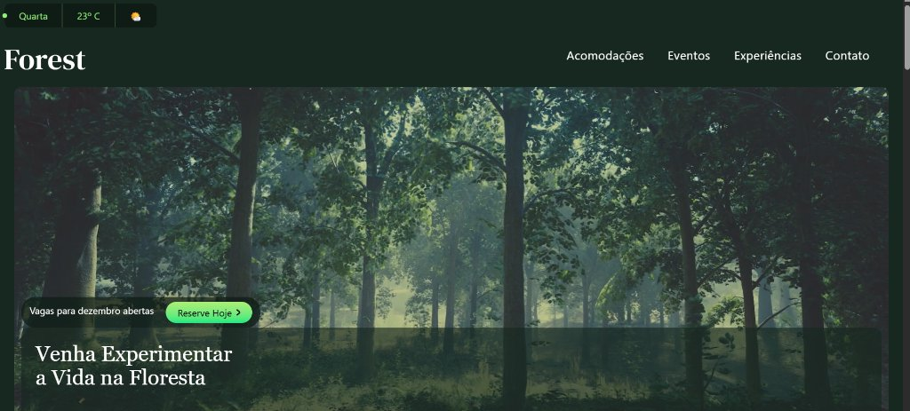

# Forest — Refúgio Natural



> **Acesse o site publicado:** [https://forest-src.vercel.app/](https://forest-src.vercel.app/)

Landing page institucional desenvolvida para a **Forest**, uma empresa fictícia especializada em locação de cabines e experiências imersivas na natureza. O projeto foi construído do zero, adotando uma abordagem de engenharia reversa visual: o layout e o comportamento da interface foram recriados a partir da observação do produto final, sem acompanhamento passo a passo de aulas ou uso de códigos prontos.

---

## Sumário

- [Visão Geral](#visão-geral)
- [Funcionalidades e Destaques](#funcionalidades-e-destaques)
- [Tecnologias Utilizadas](#tecnologias-utilizadas)
- [Decisões Técnicas e Arquitetura](#decisões-técnicas-e-arquitetura)
  - [Estilização com Tailwind CSS v4](#estilização-com-tailwind-css-v4)
  - [Grids Assimétricos e Responsividade](#grids-assimétricos-e-responsividade)
  - [Lógica Dinâmica em JavaScript](#lógica-dinâmica-em-javascript)
- [Estrutura de Pastas](#estrutura-de-pastas)
- [Principais Aprendizados](#principais-aprendizados)

---

## Visão Geral

O objetivo principal deste projeto foi consolidar o domínio prático do ecossistema moderno do **Tailwind CSS**, manipulação do **DOM com JavaScript puro** e estruturação semântica em **HTML5**.

Mais do que apenas reproduzir um design estático, foram adicionados elementos de dinamismo e microinterações pensados para elevar a experiência do usuário (UX), como detecção dinâmica de clima com troca de vídeo de fundo, carrossel de eventos com alinhamento por rolagem (_CSS Scroll Snap_) e animações com atrasos escalonados (_staggered animations_).

---

## Funcionalidades e Destaques

- **Previsão e Clima Dinâmico:** o cabeçalho calcula automaticamente o dia da semana atual e gera uma simulação de temperatura. Caso a temperatura fique igual ou abaixo de 19°C, o ícone muda para chuva e o vídeo de fundo da seção principal é alterado dinamicamente para uma cena chuvosa.
- **Hero Interativo com Vídeo de Fundo:** seção principal em tela quase cheia (`85vh` em telas médias/grandes) com sobreposição de conteúdo em camadas (_glassmorphism_ suave e gradientes).
- **Galeria de Acomodações com Grid Assimétrico:** layout em grade bidimensional combinando imagens de diferentes proporções para valorizar as fotos das cabines (`Ruby`, `Emerald` e `Saphire`).
- **Seção de Eventos com Scroll Snap:** em dispositivos móveis, os cartões de eventos podem ser navegados por rolagem horizontal suave, travando o cartão visível no centro da tela (`snap-x snap-mandatory`).
- **Menu Mobile com Efeito Blur:** menu responsivo com fundo em desfoque (_backdrop blur_), fechamento inteligente ao clicar em links ou fora do menu (_click outside_) e transição de entrada suave nos itens de navegação.
- **Microinterações:** efeitos de escala nas imagens de experiências ao passar o mouse, expansão de barras decorativas (`group-hover:w-12`) e elevação de cartões na seção de ciclo natural.

---

## Tecnologias Utilizadas

- **HTML5:** semântica estrutural (`header`, `main`, `section`, `article`, `footer`, `nav`, `form`).
- **Tailwind CSS (v4):** utilização da versão mais recente do framework, aproveitando a nova diretiva `@theme`, variáveis CSS nativas, seletores de filhos (`*:`) e compilação via `@tailwindcss/cli`.
- **JavaScript (ES6+):** manipulação nativa do DOM, manipulação de datas com `Date()`, controle de eventos de ponteiro (`pointerdown`) e alternância de classes CSS.

---

## Decisões Técnicas e Arquitetura

### Estilização com Tailwind CSS v4

O projeto já utiliza as convenções do Tailwind CSS v4, eliminando a dependência de um arquivo tradicional `tailwind.config.js` e centralizando as customizações de tema diretamente no arquivo CSS de entrada (`src/input.css`):

```css
@import "tailwindcss";

@theme {
  --color-musk-200: #acef75;
  --color-musk-300: #91ee77;
  --color-musk-400: #17e880;
  --color-musk-500: #2e482c;
  --color-musk-700: #16281f;
  --color-musk-800: #0f1c15;
  --color-musk-900: #030504;

  --animate-slideIn: slideIn 0.5s ease-out both;

  @keyframes slideIn {
    0% {
      opacity: 0;
      transform: translateX(-3.5rem);
    }
    100% {
      opacity: 1;
      transform: translateX(0);
    }
  }
}
```

A paleta personalizada (`musk`) traz tons de verde escuro, terra e detalhes em verde lima claro, criando uma atmosfera visualmente coerente com a temática florestal e de turismo ecológico.

### Grids Assimétricos e Responsividade

Para fugir de padrões repetitivos de colunas simples, a seção de acomodações emprega um grid flexível de 3 colunas e 6 linhas com ocupação diferenciada de células:

- Primeiro card: `col-span-3 row-span-3 md:row-span-2`
- Segundo card: `col-span-2 row-span-4`
- Terceiro card: `col-span-1 row-span-4`

Essa composição gera uma diagramação de revista, adaptando-se confortavelmente tanto em celulares quanto em telas amplas de desktop.

### Lógica Dinâmica em JavaScript

O script em `src/index.js` foi mantido enxuto e sem bibliotecas externas:

1. **Gestão do Menu Mobile:** abertura através do botão de hambúrguer e fechamento coordenado através de detecção de toque/clique fora do elemento (`pointerdown`) ou ao clicar em qualquer link da navegação.
2. **Atualização Temporal e Climática:**

   ```javascript
   const weekDays = [
     "Domingo",
     "Segunda",
     "Terça",
     "Quarta",
     "Quinta",
     "Sexta",
     "Sábado",
   ];
   const dateToday = new Date();
   dayInfo.innerText = weekDays[dateToday.getDay()];

   const currentTemperature = randomNumber(15, 35);
   temperatureInfo.innerText = `${currentTemperature}º C`;

   if (currentTemperature <= 19) {
     climateInfo.innerText = "🌧️";
     backgroundVideo.src = "./img/video_chuva.mp4";
     backgroundVideo.load();
   }
   ```

   Essa condicional adiciona dinamismo real à página: cada atualização simula um dia em que o hóspede pode encontrar tanto sol quanto chuva nas cabines.

---

## Estrutura de Pastas

```text
forest/
├── src/
│   ├── img/
│   │   ├── parceiros/         # Vetores e logos dos parceiros
│   │   ├── canoagem.jpg       # Fotos das atividades e experiências
│   │   ├── casa1.jpg          # Fotos das cabines
│   │   ├── floresta.jpg
│   │   ├── forest.svg         # Logotipo principal
│   │   ├── padrao.svg         # Padrão decorativo de fundo
│   │   ├── preview.jpg        # Captura de tela para o README
│   │   ├── video_chuva.mp4    # Vídeo temático de clima chuvoso
│   │   └── video_sol.mp4      # Vídeo temático de clima ensolarado
│   ├── favicon.png
│   ├── index.html             # Marcação principal da aplicação
│   ├── index.js               # Lógica de interatividade e clima
│   ├── input.css              # Arquivo de entrada do Tailwind v4 com @theme
│   └── output.css             # CSS final compilado pelo Tailwind
├── package.json
└── README.md
```

---

## Principais Aprendizados

### O que este projeto consolidou

- Capacidade de analisar um layout existente e planejar a hierarquia de tags e classes utilitárias de forma independente.
- Compreensão prática das particularidades da nova versão do Tailwind (v4), como declaração de variáveis no `@theme` e o uso de seletores combinados.
- Integração harmoniosa entre multimídia (vídeo HTML5), tipografia serifada e elementos de interface translúcidos.

---

Desenvolvido por **Esdras Ioseph Brandão**
